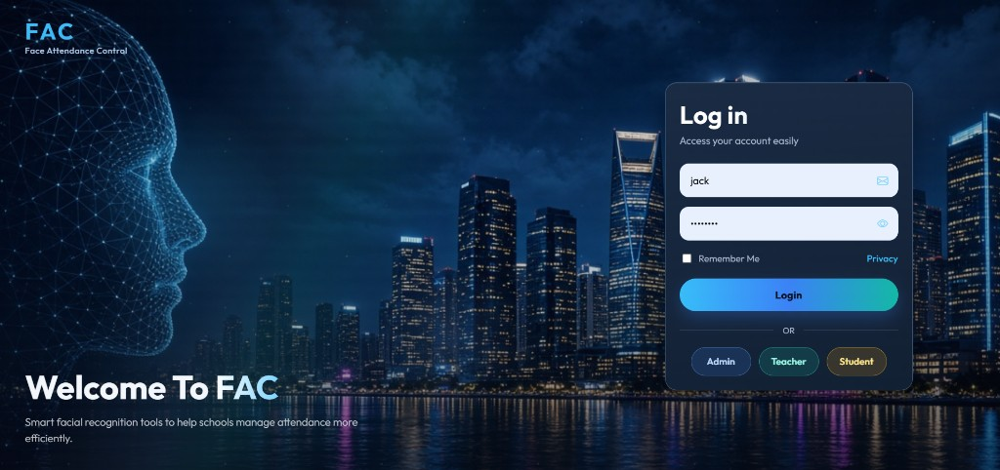
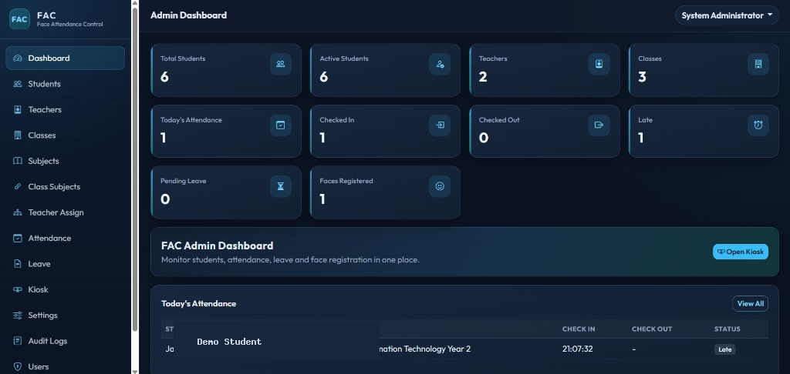
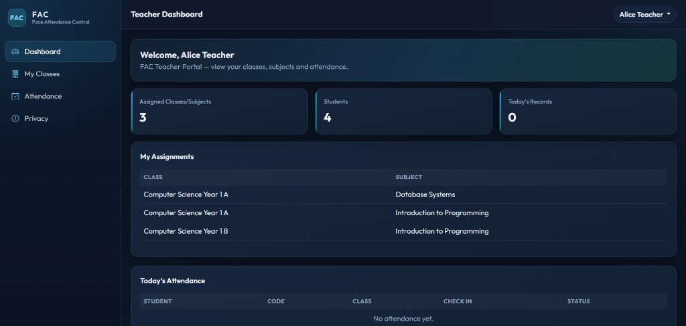
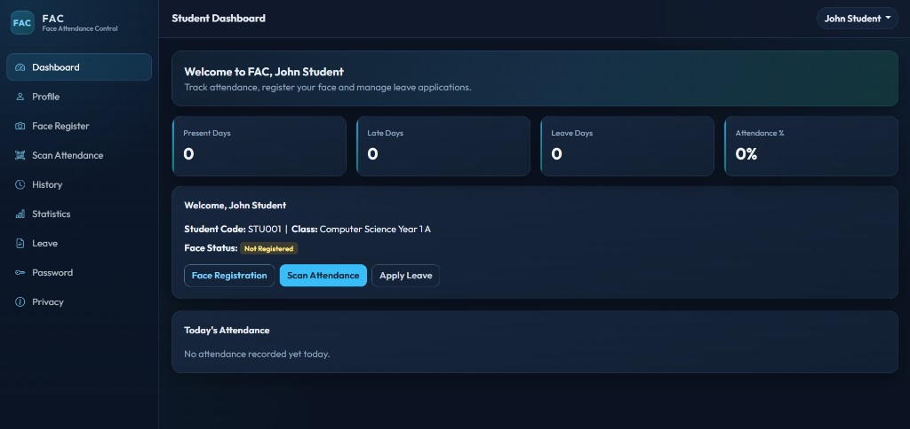

# FAC - Face Attendance Control

Web-based facial recognition attendance system for schools.  
Built with PHP (MVC), MySQL/MariaDB, Bootstrap-style UI, and browser-side **face-api.js**.

Admin, Teacher, and Student portals are included, with face registration, attendance kiosk, leave management, reports, and audit logs.

---

## Quick start (XAMPP)

1. Place the project in `C:\xampp\htdocs\project\Face Attendance System`
2. Copy `.env.example` to `.env` and fill in your local database settings
3. Start **Apache** and **MySQL** in XAMPP
4. Import `database/install.sql` with phpMyAdmin (or run `php database/install.php`)
5. Open: http://localhost/project/Face%20Attendance%20System/public/login
6. Sign in with a demo account, or click **Admin / Teacher / Student** to auto-fill the form, then click **Login**
7. Register a student face first, then test attendance from **Kiosk** or **Scan Attendance**
8. Camera access requires **localhost** or **HTTPS**

Typical local `.env` values:

```env
APP_URL=http://localhost/project/Face%20Attendance%20System/public
DB_HOST=127.0.0.1
DB_PORT=3306
DB_NAME=face_attendance
DB_USER=root
DB_PASS=your_mysql_password
APP_DEBUG=true
```

> Do not commit real passwords or production credentials.

---

## Features

- Role-based portals: **Administrator**, **Teacher**, **Student**
- Student / teacher / class / subject management
- Class-subject and teacher assignments
- Face registration and re-registration with quality checks
- Attendance kiosk: check-in, check-out, late, rest-period attendance
- Duplicate-scan protection and approved-leave blocking
- Leave applications with document upload
- Attendance history, statistics, and CSV export
- Face recognition settings and audit logs
- Privacy page
- Security: PDO prepared statements, password hashing, CSRF, role middleware

---

## Screenshots

| Login | Admin dashboard |
|:---:|:---:|
|  |  |

| Teacher dashboard | Student dashboard |
|:---:|:---:|
|  |  |

---

## Demo accounts

| Role | Username | Password |
|------|----------|----------|
| Admin | `admin` | `admin123` |
| Teacher | `teacher1` | `teacher123` |
| Student | `student1` | `student123` |

Additional demo users are included in `database/install.sql`.

---

## Folder structure

```text
Face Attendance System/
├── app/
│   ├── Controllers/      Admin, Teacher, Student, Api, Auth
│   ├── Core/             Router, Auth, Database, View...
│   ├── Middleware/       guest / auth / role / csrf
│   ├── Models/
│   ├── Services/         Face, Attendance, Upload, Audit
│   └── Helpers/
├── config/               app.php, database.php, routes.php
├── database/
│   ├── install.sql       Local install + demo data
│   ├── install_cpanel.sql
│   └── install.php
├── docs/screenshots/     README screenshots
├── public/               Front controller (open this URL)
│   ├── index.php
│   ├── assets/           css, js, face-api models
│   └── uploads/
├── views/
├── .env.example
├── LICENSE
└── README.md
```

---

## 1. XAMPP setup

1. Copy the project into your XAMPP `htdocs` folder
2. Start Apache and MySQL
3. Configure `.env` from `.env.example`
4. Import `database/install.sql`
5. Open the login page under `/public/login`

If routes return 404, enable Apache `mod_rewrite` and make sure `AllowOverride All` is set for `htdocs`.

---

## 2. Face models

Required files are already included:

```text
public/assets/vendor/face-api.min.js
public/assets/models/
```

Model types:

- Tiny Face Detector
- Face Landmark 68
- Face Recognition

If missing, download weights from the [face-api.js weights folder](https://github.com/justadudewhohacks/face-api.js/tree/master/weights).

---

## 3. Roles

### Administrator
- Dashboard and user overview
- Manage students, teachers, classes, subjects, assignments
- Face registration / re-registration
- Attendance records and CSV export
- Leave review, settings, audit logs, kiosk

### Teacher
- View assigned classes and subjects only
- View class attendance and individual student attendance

### Student
- Profile and password change
- Face register / re-register
- Scan attendance, history, statistics
- Submit leave applications

---

## 4. Attendance flow

1. Student face must be registered
2. First successful scan of the day → **Check In**
3. Later scan after the duplicate interval → **Check Out**
4. After class start + grace period → **Late**
5. During rest window → **Rest attendance**
6. Approved leave for today → scanning blocked
7. Unknown / low-confidence faces are rejected

Default face settings can be changed in **Admin → Settings**.

---

## 5. Camera notes

- Use Chrome, Edge, or Firefox
- Camera works on **localhost** or **HTTPS**
- Allow browser camera permission
- Keep one clear face in frame with good lighting

---

## 6. System flow

1. Admin creates classes, subjects, teachers, and students
2. Admin assigns teachers and registers student faces
3. Student or kiosk opens the camera and matches face descriptors
4. Attendance is stored in MySQL
5. Teachers view only assigned classes
6. Students view history, statistics, and leave status
7. Important actions are written to audit logs

---

## 7. Production / hosting notes

1. Upload the full project
2. Point the web document root to the `public` folder when possible
3. Import `database/install_cpanel.sql` into your hosting database
4. Update `.env` with your real domain and database credentials
5. Set `APP_ENV=production` and `APP_DEBUG=false`
6. Make `public/uploads` writable
7. Prefer HTTPS for camera access

Never publish `.env`, database passwords, recovery keys, or personal student data in public repositories.

---

## Security notes

- Passwords use `password_hash()` / `password_verify()`
- Session ID is regenerated after login
- CSRF tokens are required for POST requests
- Role middleware returns HTTP 403 for unauthorized access
- Uploads validate extension, MIME type, and size
- Upload directory blocks script execution
- Keep `.env` private and out of version control

---

## Troubleshooting

| Problem | Fix |
|--------|-----|
| 404 on routes | Enable `mod_rewrite` and open the `/public` URL |
| DB connection failed | Check `DB_*` values in `.env` |
| Camera blocked | Use localhost/HTTPS and allow permission |
| Models failed to load | Confirm files exist in `public/assets/models/` |
| Blank / 500 page | Temporarily set `APP_DEBUG=true` |
| Unknown face | Register that student face first |

---

## Requirements

- XAMPP (Apache + MySQL/MariaDB + PHP 8.0+)
- PHP extensions: `pdo_mysql`, `fileinfo`, `json`, `mbstring`
- Modern browser with camera support

---

## License

This project is licensed under the [MIT License](LICENSE).
